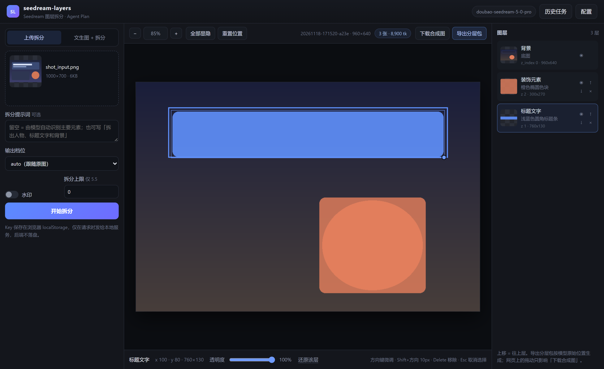
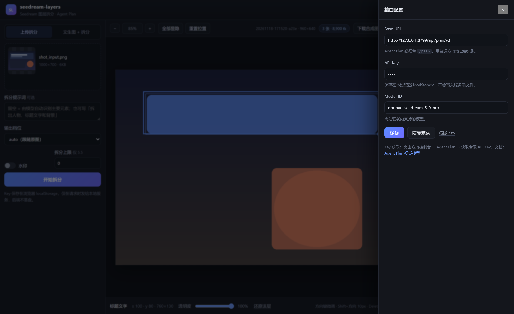

# seedream-layers

把一张压平的图，拆回可以单独移动、缩放、调透明度的图层。 

用火山方舟 **Agent Plan** 的 Seedream 图层拆分能力，输出 `1 张底图 + N 个透明图层`，
在浏览器里直接编辑、预览、导出分层图片包。纯本地运行，**API Key 只保存在你自己的浏览器里**。



## 特性

- **两种入口**：上传一张图直接拆分；或先文生图，再自动拆层，一步完成。
- **零构建前端**：原生 HTML / CSS / JS 单页，没有 npm、没有打包步骤。
- **画布编辑**：拖拽、等比缩放、调层级、改透明度、单独显隐、方向键微调。
- **分层导出**：ZIP 内含合成图、整画布对齐图层、模型原始图层、`layers.json` 和离线预览页。
- **结果可回溯**：每次任务落盘到 `output/<job_id>/`，「历史任务」可随时重新载入。
- **上游报错可读**：401 / 404 / 参数错误会被翻译成中文提示，并保留原始报文便于排查。

## 快速开始

需要 Python 3.10+。

```bash
python -m pip install -r requirements.txt
python -m uvicorn app:app --host 127.0.0.1 --port 8787
```

Windows 也可以直接双击 `start.bat`，会自动打开浏览器。

打开 [http://127.0.0.1:8787](http://127.0.0.1:8787)，点右上角「配置」：

| 字段     | 值                                                                             |
| -------- | ------------------------------------------------------------------------------ |
| Base URL | `https://ark.cn-beijing.volces.com/api/plan/v3`                              |
| API Key  | Agent Plan 专属 API Key（方舟控制台 → Agent Plan 页面获取）                   |
| Model ID | `doubao-seedream-5-0-pro` 或 `doubao-seedream-5.0-flash`（以套餐页面为准） |

> **三个必须配套**：Agent Plan 专属 Key + 带 `/plan` 的 Base URL + 套餐内的模型。
> 用普通方舟 Key 或 `/api/v3` 地址会直接 401 / 404。

配置界面：



配置存在浏览器 `localStorage`（键名 `seedream.baseUrl` / `seedream.key` / `seedream.model`），
请求时随表单发给本地服务，由本地服务转发给方舟，**服务端不写文件、不打日志**。
从旧版 `img2psd.*` 键名升级过来的浏览器会自动迁移，不需要重填 Key。

## 使用

### 上传拆分

拖拽、点击或 `Ctrl+V` 粘贴一张 PNG / JPEG，写可选的「拆分提示词」后点「开始拆分」。
上传前浏览器会先做预检：格式、≤30MB、总像素 512×512 ~ 6000×6000、宽高比 1/16 ~ 16，
不合法直接提示，不会浪费一次计费请求。

### 文生图 + 拆分

切到「文生图 + 拆分」，填生成提示词（例如"一张热带雨林风格的海报，包含大标题、副标题和装饰元素"），
模型先生成图，再对生成的图拆层。`size=auto` 时文生图按 `2K` 发起。

### 画布操作

| 操作                        | 效果                                  |
| --------------------------- | ------------------------------------- |
| 拖拽图层                    | 移动位置                              |
| 右下角圆点                  | 等比缩放                              |
| 方向键 / `Shift` + 方向键 | 微调 1px / 10px                       |
| 双击图层                    | 还原到模型给出的原始位置              |
| `Delete` / `Backspace`  | 移除选中图层（仅本次会话）            |
| `Esc`                     | 取消选择；抽屉打开时先关抽屉          |
| `Ctrl` + 滚轮             | 缩放画布；点中间百分比回到适应窗口    |
| 右侧图层列表                | 改名、显隐、上移 / 下移、移除、透明度 |

### 导出

**下载合成图**：浏览器按当前画布状态（位置、缩放、透明度、显隐）合成 PNG，所见即所得。

**导出分层包**：`seedream-layers-<job_id>.zip`，按模型原始位置生成。

```
composite.png            合成图
layers/00-背景.png        整画布尺寸
layers/01-<名称>.png      整画布尺寸、透明底，按 z_index 从小到大叠加即得原图
source/layer_01.png      模型原始输出的图层（按 bbox 缩放后的实际尺寸）
layers.json              name / z_index / description / bbox / size
viewer.html              单文件预览页，双击即用，可勾选显隐
README.txt               坐标还原说明
```

`layers.json` 中 `bbox.absolute` 是底图像素坐标 `[left, top, right, bottom]`；
`bbox.normalized` 是换算到 0~1000 的整数。还原公式：`x=left, y=top, w=right-left, h=bottom-top`。

> 分层包永远是**模型原始布局**。网页上的拖动、缩放、显隐只影响「下载合成图」，
> 这样导出的素材在再加工时不会因为手动微调而错位。

## 不花额度调试

内置一个假方舟，返回固定的 960×640 底图 + 2 个图层：

```bash
python tests/fake_ark.py     # 监听 127.0.0.1:8799
```

页面「配置」里填：

```
Base URL : http://127.0.0.1:8799/api/plan/v3
API Key  : fake
Model ID : doubao-seedream-fake
```

离线冒烟测试（校验落盘、图层对齐、ZIP、预览页，不联网、不需要 Key）：

```bash
python tests/smoke_local.py
```

README 里的两张截图就是用它跑出来的。

## 接口

| 方法 | 路径                     | 说明                                                                                                                 |
| ---- | ------------------------ | -------------------------------------------------------------------------------------------------------------------- |
| GET  | `/api/health`          | 默认配置、候选模型、尺寸档位                                                                                         |
| POST | `/api/decompose`       | multipart：`image` + `baseUrl` / `baseKey` / `model` / `size` / `watermark` / `maxImages` / `prompt` |
| POST | `/api/generate`        | JSON：文生图后自动拆层                                                                                               |
| GET  | `/api/jobs`            | 历史任务列表                                                                                                         |
| GET  | `/api/jobs/{id}`       | 重新载入某次结果                                                                                                     |
| GET  | `/files/{job}/{file}`  | 本地图层图片（只读）                                                                                                 |
| GET  | `/api/export/zip?job=` | 下载分层包                                                                                                           |

交互式文档：[http://127.0.0.1:8787/api/docs](http://127.0.0.1:8787/api/docs)

## 目录

```
app.py                 FastAPI 路由、上传预检、静态托管
ark_client.py          方舟调用封装、错误翻译、Base URL 白名单
jobs.py                任务落盘、图层下载、整画布对齐、result.json
exporter.py            分层包 ZIP、合成图、viewer.html；PSD 预留接口
web/                   前端单页（index.html / style.css / app.js）
tests/smoke_local.py   离线冒烟测试
tests/fake_ark.py      假方舟，调 UI 不花额度
docs/                  截图
output/<job_id>/       运行时产物（已 gitignore）
```

每次任务的落盘内容：

```
base.png           底图
layer_NN.png       模型原始图层
canvas/NN-名称.png  整画布对齐后的图层
result.json        画布尺寸、bbox、usage、请求元数据
*.zip              导出后生成
```

## 实现上的取舍

- **拿到响应立刻落盘**：方舟返回的图片 URL 只有 24 小时有效，`result.json` 只存本地路径。
- **画布用绝对像素坐标**：缩放只做 `transform: scale`，避免 0~1000 归一化取整带来的位移误差。
- **`alpha_composite` 而不是 `paste(mask=)`**：后者会把 alpha 再乘一次，半透明图层整体变暗。
- **上传走 multipart**：30MB 的图转 base64 会膨胀到 40MB，没必要。
- **Base URL 白名单**：默认只放行 `*.volces.com`、`localhost`、`127.0.0.1`，
  可用 `ARK_ALLOWED_HOSTS=example.com` 扩展，避免本地服务被当成任意请求的跳板。
- **上游错误统一映射为 502**，`detail` 里带 `message` / `upstream_status` / `upstream`，
  前端既能直接展示，也能展开看原始报文。

## 安全与隐私

- Key 只存在浏览器 `localStorage`，**不进仓库、不写服务端文件、不打日志**；请求结束即从内存释放。
- localStorage 是明文的：能读这个浏览器 profile 的代码就能读到 Key。本机自用场景可接受，
  公共电脑或共享账号请用「清除 Key」。
- Key 按 origin 隔离：换端口（`8787` → `8788`）需要重填。
- **不要把这个服务直接暴露到公网**：`/files/*` 与 `/api/*` 都没有鉴权，
  别人能遍历你的 `output/`，也能拿你的实例当代理刷额度。
- **不要在任何非 `127.0.0.1` 的页面上填自己的 Key**，包括别人部署的在线 demo。

## 常见问题

| 现象                                    | 原因                                           |
| --------------------------------------- | ---------------------------------------------- |
| 401 `The API key format is incorrect` | Key 不是 Agent Plan 专属 Key，或复制时带了空格 |
| 404 / `InvalidEndpointOrModel`        | Base URL 少了 `/plan`，或模型不在套餐内      |
| 提示总像素过小                          | 图层拆分要求输入图 ≥ 512×512                 |
| 拆分很慢                                | 多图层通常 1~3 分钟，服务端超时设为 300s       |
| 图层是整块方形、位置不对                | 确认 `Model ID` 属于支持图层拆分的套餐模型   |
| 导出包里图层名是中文                    | 正常，ZIP 与预览页都支持 UTF-8 文件名          |

## 已知限制

- `doubao-seedream-5-0-pro` / `5.0-flash` 不支持 `text_recognition`，文字图层仍是位图，不会变成可编辑文本。
- `layer_decomposition_options.max_images` 仅对 Seedream 5.5 生效，其他模型填了也无效。
- 只有一层撤销：图层改动仅在当前会话生效，刷新后回到模型原始布局。
- 单机单用户设计，没有并发控制、没有账号体系。

## 关于 PSD 导出

当前只导出分层图片，`exporter.build_psd()` 是预留接口（抛 `NotImplementedError`，注释里写了实现要点）。

原因：`pytoshop` 在 PyPI 只有 sdist、装不上；`psd-tools` 1.27 可以从零建 PSD
（`PSDImage.new` + `PixelLayer.frompil`），但项目当前只需要分层图片。
`aligned_file` 已经是整画布坐标，将来接入时 `top/left` 固定 0，前端不需要任何改动。

## License

[MIT](LICENSE)
